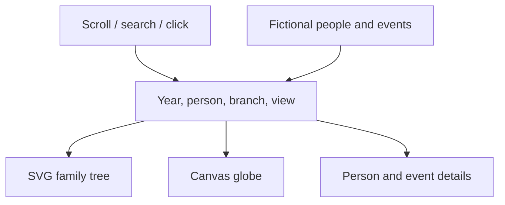
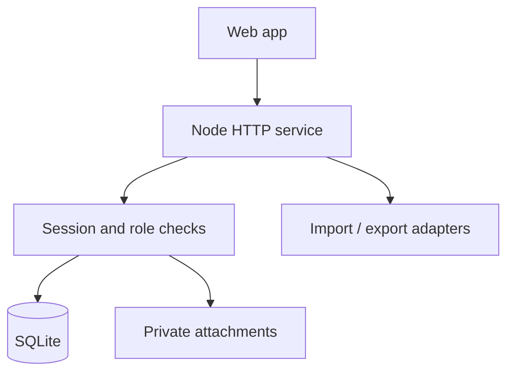

# Kin Atlas architecture

## Prototype — implemented
One static application, no build step and no third-party JavaScript dependencies. Serve `dist/` from any static host. All demo data is fictional and bundled. Selection is in memory and resets on reload; no backend, telemetry or remote geocoding.

### Files and boundaries
- `dist/data.js`: fictional people, parent/partner edges and city coordinates.
- `dist/model.js`: pure cohort, event and projection helpers; no DOM dependencies.
- `dist/app.js`: shared UI state, scroll-to-year mapping, graph and details rendering.
- `dist/globe.js`: orthographic Earth projection, front-face clipping, pointer rotation and selection.
- `dist/styles.css`: responsive layout, visual language, focus and reduced motion.
- `dist/index.html`: accessible shell and navigation.
- `tests/model.test.js`: core date/location/projection invariants using Node's built-in test runner.

The globe is a rotatable orthographic projection, not a satellite renderer. Its original coarse continent polygons are schematic. Replace with a bundled, attributed Natural Earth dataset before treating map boundaries as authoritative.

## MVP — planned, not implemented
Keep one repository and one deployable Node application. Serve the existing client and `/api` from the same origin. SQLite stores structured data; an application-owned directory stores originals. Docker volume persists both. No queue, separate API gateway or mandatory cloud provider.

### Entities
| Entity | Main fields |
|---|---|
| Tree | id, name, ownerId, version |
| Person | id, treeId, name, visibility, biography, version |
| Relationship | id, treeId, fromId, toId, type, sourceId, certainty |
| Event | id, personId, type, dateStart, dateEnd, precision, placeId, sourceId, certainty, confirmedCurrentAsOf |
| Place | id, label, latitude, longitude, precision |
| Story | id, treeId, title, text, createdBy, version |
| Attachment | id, treeId, storageKey, originalName, MIME, size, SHA256 |
| PersonTag | personId, storyId or attachmentId |
| Source | id, kind, reference, importedAt, originalAttachmentId |
| Membership | userId, treeId, role (owner/editor/viewer) |

Dates carry precision (year/month/day/range/unknown); never convert an unknown date to January 1. The prototype uses year-only dates. Biological/adoptive parent edges are directed parent→child. Partner edges are symmetric. Validate references, duplicate edges and ancestry cycles within a transaction.

### API sketch
- `GET /api/trees/:id` reads a permitted snapshot.
- `PATCH /api/trees/:id` applies validated edits with expected version; stale updates return 409.
- `POST /api/trees/:id/import/preview` parses GEDCOM into a draft; `POST .../commit` confirms reviewed changes.
- `POST /api/trees/:id/attachments` accepts allowlisted files, initially <=25 MB; metadata and blob lifecycle stay consistent.
- `GET /api/attachments/:id` checks membership before streaming.
- `GET /api/trees/:id/export` returns versioned JSON + original attachments in ZIP.

Use a maintained authentication library, secure HTTP-only sessions, CSRF protection and server-side membership checks; evaluate the implementation at MVP kickoff. Never put service credentials in the browser. Uploaded PDFs download by default or display in a sandbox; reject executable/HTML/SVG uploads initially. Do not treat MIME headers alone as validation. Backups contain personal data and must inherit private access.

## Scope and operational trade-offs
SQLite handles one modest private installation well; do not claim horizontally scalable writes. Start with a single process and scheduled consistent backups. Postgres/S3 adapters are optional future work, not mandatory dependencies. Transcription is an optional provider adapter invoked with consent; no default external AI service. A Geni adapter is deferred until a permitted access method is established.

## Public repository boundary
Commit source, tests, fictional fixtures, PRD, architecture, MIT license and contribution guidance. Exclude private datasets, `.env`, uploads, database files and host-specific identities. Hosting metadata for the preview is not needed in the GitHub distribution. A repository is the GitHub project for this first version; a separate GitHub Projects board is unnecessary overhead.
